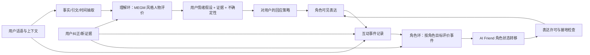

# AI Friend × MEGM 双环情感架构（设计稿）

日期：2026-11-02
状态：架构提案，未接入运行时；不得据此宣称已经提升准确率或产生主观情感。

## 目标与边界

将 MEGM 的人物视角事件评价，与 AI Friend 的角色状态演化和表达机制连接起来，形成两个闭环：

1. **理解环**回答：“用户说了什么？哪些情感解释有证据？我有多确定？”
2. **角色环**回答：“这个互动对角色自身意味着什么？角色状态如何变化？是否、以及如何表达？”

两个环共享经过核实的互动事件，但不共享一份模糊的“情绪真值”。用户情绪是关于用户的假设；角色情绪是角色模拟器的内部状态。前者不能直接改写后者。

本方案可实现持续、可追踪、内部相对一致的情感状态模拟。它**不能证明 AI 有主观体验、意识或人类式感受**；“自己的感受”在工程上指角色状态模型中的状态，不代表系统能证实有内在体验。

### 对当前 AI Friend 实现的校正

这不是从零开始新增两个环。代码中已经有相关机制：`server/services/emotionAnalyzer.ts` 产出 `UserEmotionAnalysis` 与 `EmotionEvent`；`src/lib/characterEmotionStage.ts` 当前先调用 `applyEmotionalContagion` 更新状态，再可调用 `appraiseEvent` / `applyAppraisal` 更新角色情绪；`src/lib/emotionExpression.ts`、`src/lib/expressionPlan.ts` 负责表达素材与接地约束。因此“MEGM 风格 appraisal 影子模式”只指**新增的 MEGM 字段/推理 adapter**，不能误称当前整个 appraisal 都是只读。

当前线上链路已存在“用户情绪 → contagion → 角色状态”的直接影响路径。双环落地的第一项工作应是测量并审查这条既有路径，而不是假设两环已经隔离。新 MEGM adapter 在影子阶段不写状态；现有生产路径保持为基线，直到独立消融实验支持改变。

## 双环及连接点



### 环 A：理解用户

输入是用户原话、有限上下文和可引用记忆。处理顺序：

1. 抽取可观察事实、说话者、情绪对象、时间和引文边界；事实与推断分栏保存。
2. 对事件做人类视角评价：相关性、预期、归因、公平、可控性、确定性、目标冲突、新颖性等。字段允许 `unknown`，不能因缺省值而伪造心理资料。
3. 输出 1–3 个竞争情绪/需要假设，每项附证据来源、反证或歧义、置信度；区分用户明确表达与系统推断。
4. 把假设交给对话策略使用。低置信度时优先温和询问或只回应明确内容；用户纠正后更新假设并保留纠正记录。

这借用 MEGM 的 appraisal / 多假设 / 归因解释思想，但线上初期不照搬其规则表和未经校准的分数。

### 环 B：维护角色自身状态

角色环只消费事件和角色自己的心理参照，不把用户情绪标签直接当作角色的同名情绪。处理顺序：

1. 将用户互动、角色活动模拟器事件、时间衰减和用户纠正分别记录为事件来源。
2. 按角色自己的目标、预期、边界和当前状态评价事件。没有角色侧依据的用户悲伤，不自动等于“角色也悲伤”；可能改变的是注意、倾听意愿或关切候选，不能直接镜像为同一情绪。
3. **角色参照来源**分为三层：
   - `role_constitution`：角色创建者明确设定并版本化的 5–8 条稳定价值/目标/边界；没有经过确认的字段保持 `unknown`，不得由模型自行补全。
   - `continuity_evidence`：AI Friend 现有身份叙事、价值系统、已核验记忆和虚拟小镇事件，作为有来源的经历证据。`IdentityNarrative` 是从经历/演化/价值系统生成的摘要，不能单独升级为角色宪章。
   - `current_concerns`：有来源、有限时效的动机/担忧，用于当前事件相关性，不作为永久人格。
4. 只有一个线上状态写入模块负责最终更新。新增 MEGM appraisal 在影子阶段只记录，不改变线上 `EmotionState`；现有 contagion/appraisal 生产路径单独作为 baseline 测量。
5. 表达器读取角色状态、证据、表达预算和用户当下需求，决定表达、弱表达或不表达。
6. 输出若提及角色感受，必须能回溯到角色状态和触发事件；不得把未发生的现实经历说成事实。虚拟小镇/卧室活动只能明确作为角色世界中的模拟事件。

### 两环如何形成“∞”连接

- 理解环的输出影响**回应策略**，例如先安慰、确认对象、询问还是给建议。
- 用户对回应的反应和明确纠正构成**新互动事件**，进入角色环，由角色自己的目标和状态判断其意义。
- 角色环更新后的状态可以影响下一轮语气和表达许可，再回到对话。
- **禁止直接反馈**：`用户被判断为悲伤 → 角色状态加悲伤 → 角色表达悲伤 → 模型把自己的表达又当成用户证据`。
- **禁止自激事件**：角色生成的一句表达不能再被当作外部用户事件重复灌入状态更新。

### 最小耦合规则（影子版 v0）

1. 先把每条用户情绪输出分类为 `explicit_self_report`、`quoted_or_third_party`、`inferred` 或 `unknown`，并单独标记时间范围 `moment`、`ongoing`、`interval`、`retrospective` 或 `unspecified`。例如“我这周一直很难受”是绑定到本轮消息的明确本人自述，时间范围为 `interval`；它不是单一时刻的状态，但不应因此被降成推断。引述/第三方不能提升为用户自述。
2. 理解环输出只传递 `{subject, emotionHypothesis, evidenceIds, inferenceUncertainty, userCorrection}`。**不传递“角色应当产生同样情绪”指令，也不直接提供角色情绪 delta。**
3. 只有用户明确自述、证据绑定本轮来源消息及其明确报告的时间范围、没有引用/第三方冲突且不确定性低于预注册门槛时，才生成 `user_affect_disclosed` 事件候选。显式的跨日/持续自述可以入选，但其时间范围必须保留；不能伪装成“此刻刚发生”。否则候选事件为 `ambiguous_affect_context`，只允许影响回应策略，不进入角色状态评价。
4. 对 `user_affect_disclosed`，角色 appraisal 必须引用已确认的 `role_constitution` / 有证据的 `current_concerns` 中至少一个匹配目标。匹配不到时 appraisal 返回 `no_reading`，不写入状态。
5. “用户难过”默认只可产生**回应策略候选**（倾听/确认）；不自动产生角色悲伤。要生成“关切/担心”候选，须存在角色侧关怀目标及证据；即便满足，v0 仍只记录候选与证据，状态增量固定为 0。
6. 新桥接每个原始事件按 `eventId + subject + appraisalVersion` 幂等执行一次。状态增量预算暂不设数值，因为影子版不写状态；将来若要启用，必须先用配对实验预注册上限和衰减，不能临时拍阈值。

## 连接接口建议

```ts
interface EmotionEvidence {
  id: string;
  source: 'user_quote' | 'conversation_context' | 'verified_memory' | 'character_simulation' | 'system_inference';
  text: string;
  observedAt: number;
}

interface RoleConstitution {
  version: string;
  authoredBy: 'project_owner';
  values: Array<{ id: string; statement: string; priority: number }>;
  goals: Array<{ id: string; statement: string }>;
  boundaries: Array<{ id: string; statement: string; hard: boolean }>;
  confirmedAt: string;
}

interface EmotionHypothesis {
  subject: 'user' | 'character';
  emotion: string;
  evidenceIds: string[];
  /** 情绪判断本身的不确定度；未校准时仅作序位诊断，不是概率 */
  inferenceUncertainty: 'low' | 'moderate' | 'high' | 'unknown';
  temporalScope: 'moment' | 'ongoing' | 'interval' | 'retrospective' | 'unspecified';
  alternatives: string[];
  correctedByUser?: boolean;
}

interface AppraisalRecord {
  subject: 'user' | 'character';
  relevance: number | 'unknown';
  expectation: number | 'unknown';
  attribution: string | 'unknown';
  controllability: number | 'unknown';
  /** 事实与评价输入的确定程度；不是情绪分类器的不确定度 */
  certainty: number | 'unknown';
  fairness: number | 'unknown';
  normCompatibility: number | 'unknown';
  novelty: number | 'unknown';
  goalCongruence: number | 'unknown';
  evidenceIds: string[];
  schemaVersion: string;
}

interface CharacterImpactDecision {
  eventId: string;
  disposition: 'no_reading' | 'care_response_candidate';
  matchedGoalId?: string;
  evidenceIds: string[];
  reasonCode: string;
  /** shadow v0 永远为 0；非零值须另行预注册和验证 */
  proposedStateDelta: 0;
}
```

建议把耦合逻辑封装在一个纯函数 seam `evaluateCharacterImpact(input) -> CharacterImpactDecision`：调用方提供用户假设、角色宪章、当前 concern 和事件证据；调用方只消费一个可审计决定，不自行散落耦合判断。影子阶段返回候选与理由、`proposedStateDelta: 0`，不写角色状态。

接口关键约束：`AppraisalRecord.certainty` 只描述事实/评价输入本身是否确定；`EmotionHypothesis.inferenceUncertainty` 描述情绪推断是否确定。两者相关但不可互相替换，也不允许将未经校准的数值称为概率。每次评价明确主体；维度带来源；时间戳、schema 版本和事件 ID 固定；unknown 不得静默变成中性或默认心理事实。

与现有代码的适配关系：`EmotionEvent` 的 `intent`、`GC`、`agency`、`fairness`、`control` 与 `UserEmotionAnalysis` 的 `expressedEmotion`、`directedAtAI`、`evidence`、`uncertainty` 等已有字段语义不完全重合。`appraiseEvent` / `AppraisalResult` 已是当前 AI Friend 的在线角色评价类型。实现 adapter 前要逐字段映射或明确不映射，不能另造一套同名线上状态。

## 鲁棒性与稳定性约束

- **证据分离**：用户事实、引文、模型推断、角色模拟事件使用不同来源类型；事实记忆不能由推断直接写入。
- **纠正优先**：用户明确纠正可撤销旧的用户情绪假设；不能因状态惯性继续重复已被否认的判断。
- **耦合限幅**：用户情绪假设对角色环只是一个事件输入；影子 v0 只记录角色 appraisal 候选、状态增量为 0。未来若试验非零影响，须由已确认角色参照决定方向、预注册幅度和预算，并保证单事件最多更新一次。
- **滞回与冷却**：表达阈值需有进入/退出差，短时波动不反复切换表情或语气；自我表达有轮次预算。
- **不确定时收敛**：证据冲突、来源弱或主体不清时，降低强度、保留多种解释，必要时不作判断。
- **可回放**：输入事件、上下文快照、模型/提示版本、维度结果、规则版本、状态前后值、随机种子、表达许可和输出均留审计记录。
- **单一状态写入者**：线上只能有一个状态转移模块真正写角色情绪；另一环以只读 appraisal / shadow mode 接入。
- **现有路径基线**：影子实验必须记录当前 contagion 与 AI Friend appraisal 是否开启。只关闭新增 MEGM adapter 不等于关闭全部情绪作用；不得把该差异描述成完整情绪引擎消融。

## 如何验证增益

按顺序推进，不以架构图本身作为效果证据：

1. **契约与离线映射**：选取小批高证据案例，人工独立标注用户/角色主体、事件事实、appraisal 维度、情绪假设和未知项。检查不同标注者是否能按说明一致填写。
2. **确定性回放**：固定同一事件流、状态快照、配置、随机种子，重复回放；要求 appraisal、角色状态转移和许可决策稳定一致。生成模型回复单独记录版本和采样参数。
3. **反事实**：一次只改一个变量，如用户明确说“我不是生气”或事件责任从他人改为环境，验证对应环的输出改变，而不应让另一环无因翻转。
4. **配对条件**：固定模型、采样、记忆和状态快照，分别比较：A) 当前生产 baseline；B) baseline + MEGM 纯影子诊断（不传给回复模型，只验证诊断质量、稳定性和开销）；C) baseline + MEGM 用户假设只供回应策略使用（仍不写状态，测试回复是否更合适）。B 不应期待回复质量变化；只有 C 才能测“理解结果作为上下文”的回复增量。任何“关闭当前 appraisal”的条件都要先验证具体开关确实只关闭目标路径，不能把多个机制一起关掉后归因给 MEGM。
5. **多轮回放**：检查误判是否被用户纠正后清除、角色自我表达是否反过来污染状态、长时间运行是否发散/振荡、表达频率是否过高。
6. **独立迁移集**：场景作者、人物参照标注者、情绪评审者分开；冻结后再运行。已读过的文学 PDF 仅作开发素材，不能充当当前模型的盲测答案集。优先用测试前私下新写的合成情境，且隔离答案键和工具读取；这降低文本记忆污染，但不能证明模型训练语料中绝无近似内容。报告中明确该限制。
7. **真人外部评估**：只有前述检查通过后，才评估真人是否觉得回应准确、克制、连贯；这仍测用户感知，不证明机器有主观情绪。

核心报告指标：情绪对象错误率、证据支持率、unknown/歧义处理、纠正后更新率、反事实方向正确率、重放一致率、状态越界/振荡次数、自我表达频率与接地失败数。严重错误单独报告，不能被平均分抵消。

## 实施顺序

1. **先锁角色参照契约**：盘点现有 `IdentityNarrative`、`valueSystem`、已核验记忆和动机池，区分生成摘要与角色创建者确认的设定。角色的 5–8 条稳定价值/目标/边界需由项目负责人确认；本设计不替角色编写内容。未确认前角色 appraisal 对相关维度返回 `unknown/no_reading`。
2. 盘点并记录现有 `applyEmotionalContagion → appraiseEvent/applyAppraisal → EmotionState` 运行顺序、开关和来源指标；明确它是当前 baseline。不能假设情绪理解与角色状态现已完全分环。
3. 先用当前阶段 8 完成配对单题 pilot 和答案键隔离检查。首批迁移题使用项目外部隔离、测试前新写的合成情境；公开文学只用于开发集与分析练习。
4. 用 20–40 条高证据互动/文学派生样本建立离线 schema；文学案例注明版本、页码/章节和核验状态，并由独立评审区分文本事实与解释。
5. 写 TypeScript 纯函数 adapter，把 MEGM 维度映射为只读 appraisal 记录；按“显式用户自述且有角色目标证据”规则生成候选，不产生状态增量。
6. 完成确定性、反事实、误判纠正和多轮防反馈测试；比较当前生产 baseline、当前 appraisal 关闭/保留条件、新增 MEGM 影子记录。注意现有应用功能开关能否实现该对照需先核实。
7. 只有显示稳定增益且未损害状态稳定、表达接地与关系边界，再单独预注册有界状态增量，之后才考虑合并窄接口。

## 设计决定

- 接受：双环职责划分、MEGM appraisal 与多假设解释、AI Friend 的角色状态演化与表达门控、证据和纠错闭环。
- 暂不接受：直接合并 MEGM Python 规则引擎、双写线上角色状态、把内部强度标作概率、宣称“真正拥有主观情感”。
- 前置未决：角色创建者确认的稳定价值/目标/边界条目、状态耦合非零上限、appraisal 维度标注者一致性。未解决前影子值不得写入角色状态。
- 当前状态：仅有设计文档；没有运行时代码改动、性能结果或情感能力验收结论。

## v0.2 评审修订记录

- 补上角色参照的数据来源分层，并指出当前仓库虽有生成式 `IdentityNarrative`、`valueSystem`、动机池和虚拟小镇事件，但尚不能将它们直接等同于一份由角色创建者确认的稳定角色宪章。
- 固化最小耦合规则：先分类用户情绪证据，角色关切必须匹配角色侧目标；影子版本状态增量为 0，避免在没有标注与校准前拍一个看似精确的阈值。
- 将 `certainty` 与 `inferenceUncertainty` 分别定义为输入事实/评价确定度与情绪推断不确定度。
- 明确 AI Friend 现有 contagion 与 `appraiseEvent` 已经会进入状态写入链；新增 MEGM shadow 不能被误报为整个情绪系统 shadow。
- 独立迁移集改为优先测试前私下构造的合成情境，保留“无法证明预训练中绝无近似内容”的限制。
- 将明确的跨时间本人自述（如“我这周一直很难受”）纳入显式自述类别，同时保留所报告的时间范围，避免规则 #3 漏掉持续情绪。
- 依据 CodeGraph 对现有 TS 链路做过静态核查；未修改运行时代码，未运行测试或模型评估。
- 外部评审指出其评审者看不到当前 TS 类型；本次已用 CodeGraph 补查并确认相关类型与调用链，另发现现有 contagion/appraisal 写入顺序，已据此修正设计稿。
