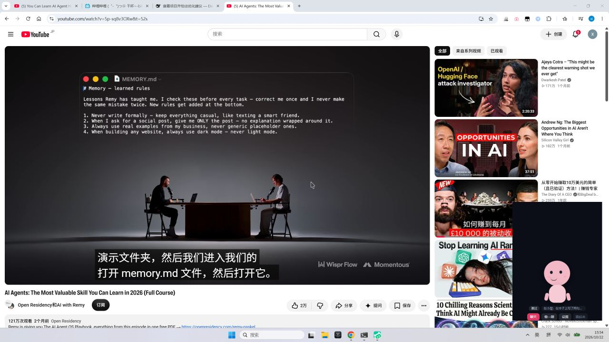

# v1.83 桌宠 + 她看屏幕（Electron 壳 + 截屏 OCR + 四种策略）

> 用户裁定：加 Electron 壳、占位形象、截屏四种模式**都要**做成可选、文件交互走"白名单 + 每次确认"。

## 一、她真的能看到屏幕了（不是模拟）

```
架构（为什么这样拆）：
  · PowerShell 直接抓屏 → **被 Windows 杀软当恶意脚本拦掉**（"ScriptContainedMaliciousContent"）
  · 所以抓屏放在 **Electron 主进程**（desktopCapturer，1280×720 JPEG ~123KB / 469ms）
  · PowerShell 只负责 **OCR**（Windows.Media.Ocr，中文引擎 zh-Hans）——这条不被拦
  · Node 服务：策略/授权/审计/OCR 编排；她的工具 look_at_my_screen 拿 OCR 文本

端到端实测：
  1) 撤回授权后问她"看我一眼屏幕" → 她说「屏幕我看不了，还没被允许，点一下桌宠上的"允许"才行」（pendingApproval=true）
  2) 点允许 → 65s 后（避开限频）再问 → 她真的截屏 + OCR 1073 字（861ms），并读出：
     「屏幕上像是某个 AI 相关的页面，中间有一块写着 "Lessons Remy has taught" 之类的规则清单…
       旁边还有 YouTube、Hugging Face 的标签页…看着像你在整理一套给助手用的规则？」
```

## 二、四种截屏策略（桌宠设置里点选，写成 option 而不是写死）

| 模式 | 你主动说 | 她主动看 | 定时上限 |
|---|---|---|---|
| `on_demand_10`（默认） | 直接截 | 需你点一次"允许"（15 分钟免问） | 10 分钟/张 |
| `on_demand_5` | 直接截 | 同上 | 5 分钟/张 |
| `explicit_only` | 直接截 | **不允许**（她会如实说） | 无 |
| `auto_no_prompt` | 直接截 | 直接看（不弹授权，隐私风险最高） | 10 分钟/张 |

附加护栏（所有模式生效）：
```
· 前台是密码/银行/支付/登录类窗口 → 直接跳过，不截
· 最小间隔 60s；审计账本 memories/screen_captures.jsonl；截图保留 7 天自动清理
· 截图只存 memories/screens/（gitignore），你随时可查/清空
```

## 三、Electron 桌宠（占位形象）

```
npm run desktop:pet
  → 若无后端会自动先起 server（3000）
  → 透明置顶无边框窗口 300×400，加载 http://127.0.0.1:3000/pet
  → 每 1.5s 轮询截屏请求，截完回写；每 3s 刷新她的状态

界面（占位形象，纯 CSS 简笔小人；以后换成 PNG 只改 PetApp 里那一块）：
  头/身体/眼睛（会眨）/嘴（低落时下弯）/腮红；呼吸+摇摆动画
  气泡说话：点她 → POST /api/pet/interact → 规则回复（不花 token）
  授权卡：她想看屏幕时出现「允许 / 拒绝」
  设置面板：四种截屏策略单选 + 今日已看次数
  按钮：聊天（开主窗口）/ 看一眼 / 设置 / 藏起来；顶部 24px 可拖动
  快捷键：Ctrl+Shift+P 打开聊天
```



> 图里右下角：粉色的占位小人 + 「难过」+「在小屋：在本子上写了两句，又划掉了」+ 按钮行。

## 四、踩过的坑（都留档）

```
① PowerShell 抓屏被杀软拦（AMSI）：改用 Electron desktopCapturer；PS 只做 OCR
② .ps1 有中文必须存 UTF-8 **BOM**，否则 Windows PowerShell 5.1 读乱直接 exit 1
③ 本会话环境有 ELECTRON_RUN_AS_NODE=1：会让 electron 以纯 Node 跑（require('electron') 返回 undefined）
   → scripts/run-pet.cjs 里显式删掉该变量再启动
④ package.json 是 "type": "module"：Electron 入口必须用 .cjs，否则 require 报错
⑤ 截屏文件名一度出现双点（ISO 字符串尾部 .123Z）→ 已按秒截断
```

## 五、还没做（下一批）

```
· 文件交互（移动/重命名/新建）——按你选的"白名单目录 + 每次弹窗确认 + 回收站可撤销"来做
  授权 UI 复用桌宠的授权卡；审计账本单独一个；MCP 的 write 类工具走 requireApproval
· 形象替换：给我一套 PNG（256×320、6 状态 × 4 帧），我把占位小人换掉
· 她自己的视觉理解：目前是 OCR 文本；若以后换/加视觉模型，可直接把 JPEG 喂进去
```

## 六、验证

```
全量 1844/1844 ｜ tsc 双配置 0 ｜ vite build ✓
新增单测：screenWatch 13（四策略/限频/授权/敏感窗口/OCR 压缩）、agentLoop 39（工具表 11 个 + 看屏幕路由）
现场：截屏→OCR→她读懂屏幕 全链路跑通；进程已停、memories/ 已还原、临时 spike 已删
```
