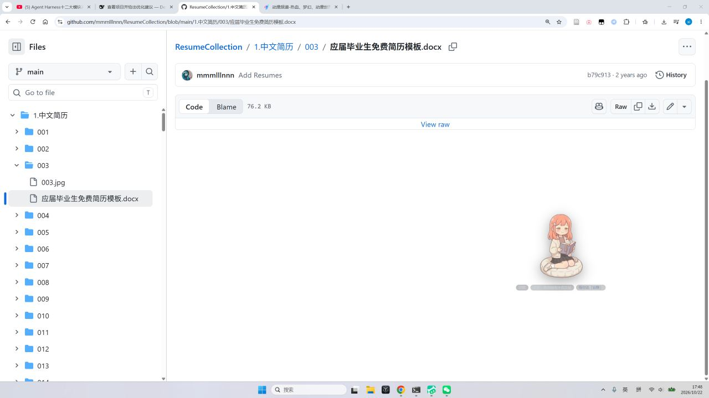
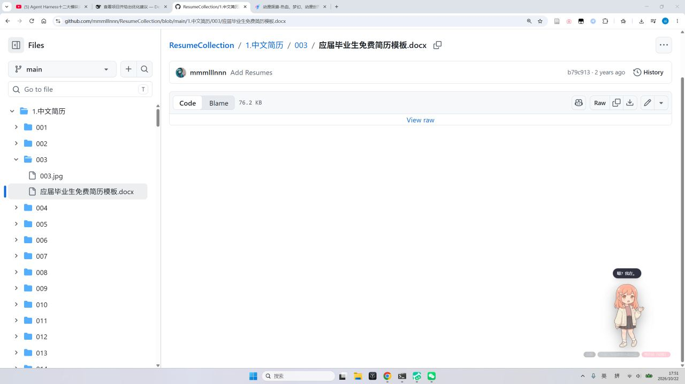

# v1.88 桌宠：去掉所有按钮 + 语音唤醒（出声取消，只冒气泡）

> 用户："把下面的按钮都取消掉，加一个语音唤醒，然后我可以通过语音跟她交流，她不需要发声，发气泡就可以。"

## 一、按钮全去掉了

```
删掉：聊天 / 看一眼 / 设置 / 藏起来（底部那排）
删掉：设置面板（四种截屏策略的 UI 入口）
保留：她本人（摸 / 拖动 / 双击挥手）＋ 状态小字（情绪·小屋·聆听提示）
保留：屏幕授权卡（她想看你屏幕时的「允许/拒绝」——这是安全确认，不是功能按钮）

替代入口（不占桌面）：
  右键她 → 菜单：打开聊天窗口 / 退出桌宠
  Ctrl+Shift+P → 打开聊天窗口
  Ctrl+Shift+Q → 退出桌宠
```



## 二、语音唤醒：说「安雅」→ 说一句话 → 她冒泡回你

```
唤醒词：安雅 / 小雅 / anya（可改 scripts/voice-config.json）
流程：  听到唤醒词 → 她冒泡「嗯？我在。」+ 头上一圈很淡的聆听光环
      → 之后你说的一句话被听写成文字 → 走 /api/chat（和打字完全同一条管道）
      → 她的回复**只用气泡显示**，不出声（TTS 不走这条路）
说完一句后自动回到"等唤醒"状态；没听清会说「没听清，再说一遍？」
```



### 技术选择：为什么用它

```
Electron 自带的 Web Speech 依赖 Google 服务，本地用不了 → 不走
Windows 系统自带 **System.Speech 中文识别引擎（zh-CN）** → 离线、免费、无需下载模型
   · 麦克风长驻监听：scripts/voice-wake.ps1（PowerShell）
   · 唤醒用「限定词法」只认 3 个词（准确率高、不会被闲聊误触）
   · 唤醒后用听写语法（DictationGrammar）听一句话
   · 事件写 memories/voice_events.jsonl → server 增量读取 → 桌宠每 600ms 轮询 /api/pet/voice
```

### 端到端验证（用 TTS 生成 WAV 喂给识别器，不依赖麦克风）

```
输入 WAV①「安雅」→ 事件 {"kind":"wake","text":"安雅"}
输入 WAV②「我今天有点累」→ 事件 {"kind":"utterance","text":"我今天有点累"}
→ 服务端读到事件 → 桌宠冒泡 → /api/chat 走完整对话管道（日志有 Agent rounds=1）
```

## 三、开关与配置

```
ENABLE_VOICE_WAKE=true       # 本机 .env 已开；代码默认关（新机器行为不变）
scripts/voice-config.json    # 唤醒词列表
npm run voice:test           # 手动起识别器（调试用）
```

## 四、踩过的坑

```
① PowerShell 语法：if 不能当内联表达式写进方法参数（[TimeSpan]::FromSeconds(if ...)）→ 先算变量
② Grammar 的语言必须显式指定 zh-CN，否则 "language for the grammar does not match"
③ DictationGrammar 的 Culture 是只读的 → 用 GrammarBuilder.Culture + AppendDictation() 才能中文
④ -File 传数组参数会被拼成一个字符串 → 改成 -WavCsv "a.wav,b.wav" 再 split
```

## 五、验证

```
语音识别链：TTS WAV → wake/utterance 事件 ✅（中文识别准确）
渲染链：注入事件 → 气泡「嗯？我在。」✅（截图）
对话链：utterance → /api/chat → 气泡回复 ✅（服务端日志有 Agent 回合）
全量 1856/1856 ｜ tsc 0 ｜ vite build ✓ ｜ 进程已停、memories 已还原
```

## 六、唤醒词改为「二丫」（v1.89 追加）

> 用户："唤醒词为二丫"。

```
配置：scripts/voice-config.json
  wakeWords: ["二丫","二丫在吗","嗨二丫","二丫二丫","小二丫"]
  wakeMinConfidence: 0.93   ← 新增的置信度闸门
```

**实测（TTS 生成 WAV 喂识别器，全部中文识别）**

| 说的话 | 结果 | 置信度 |
|---|---|---|
| 二丫 | 唤醒（text=二丫） | 0.991 |
| 二丫在吗 | 唤醒（text=二丫在吗） | 0.993 |
| 嗨二丫 | 唤醒（text=嗨二丫） | 0.991 |
| 二丫，我今天有点累 | 唤醒（text=二丫） | 0.988 |
| 安雅（旧唤醒词） | **拦下** | 0.900 |
| 二娃 | **拦下** | 0.587 |
| 二亚 | 唤醒（同音字，属正常） | 0.988 |
| 今天天气不错 / 我明天要上班 | 拦下 | — |

为什么加置信度闸门：限定词法会把**任何语音**往最近的唤醒词上靠（说"安雅"会被硬映射成"二丫"）。
真说「二丫」置信度 ≈0.99，硬映射过来的只有 0.90 以下 ⇒ 阈值 0.93 正好分开。

调节建议：
```
容易唤醒不动 → wakeMinConfidence 调低到 0.85
被别的话误唤醒 → 调到 0.95~0.97
想恢复「安雅/小雅」→ 直接加进 wakeWords 数组（同时得接受同音误唤醒）
```