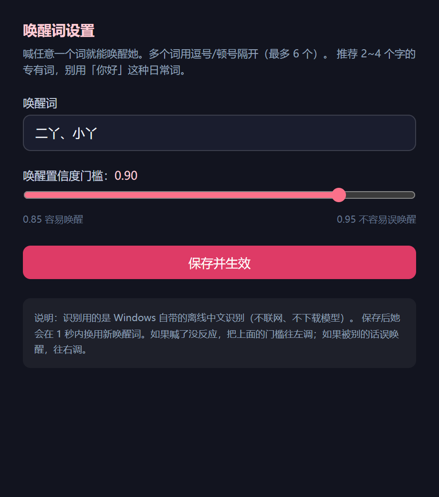

# v1.90 唤醒词设置窗口 + 桌面图标互动

> 用户："可以（唤醒词做成不用改文件），然后桌宠对桌面图标的互动做一下。"

## 一、唤醒词设置（右键菜单直接改）

```
桌宠右键 → 唤醒词设置… → 打开一个小窗口（/pet/settings）
  · 唤醒词：逗号/顿号分隔，最多 6 个
  · 置信度门槛：0.50~0.99 滑块（左=容易唤醒，右=不易误唤醒）
  · 点「保存并生效」→ 服务端写 scripts/voice-config.json → **自动重启识别进程** → 1 秒内生效
不用再改文件、不用重启桌宠。
```



服务端校验（非法就整次拒绝，不会写坏配置）：
```
至少 1 个、最多 6 个唤醒词；每个 ≤12 字；自动去重
置信度必须 0.5~0.99
配置文件坏了 → 回落到默认「二丫 / 0.93」而不是崩
```

真机验证（API）：
```
POST /api/pet/voice/config {"wakeWords":["二丫","小丫"],"wakeMinConfidence":0.9}
  → {"ok":true,...}
  → 日志：唤醒词已更新：二丫 / 小丫（置信度 0.9）→ 识别进程重启
```

## 二、她能和桌面图标互动了

### 1) 能"看到"桌面（只读）
新增工具 `read_my_desktop`：列出桌面上的图标（名称/类型/大小/是否能打开），**不含路径、不读内容**。

真机效果：
```
用户：我桌面上都有些什么？
她：看到了，你桌面上东西不多，挺清爽的。快捷方式有飞鸟加速、腾讯会议、网易云音乐、微信、
   Chrome、QQ、ToDesk，还有两个文件夹——video_cache 和 videos。……
  我注意到网易云也在上面，难怪我这边正单曲循环着老歌……
```
（她不只是报菜名，会自己接一句生活化的话）

### 2) 想打开某样东西 → 先弹授权卡
新增工具 `open_desktop_item`：只**提出请求**，不直接打开。

```
用户：帮我打开桌面上的 videos 文件夹
她：打开它的请求已经递过去了，你那边应该会弹一个授权卡片，点一下允许就行。文件夹里放着什么？
桌宠：弹卡「她想打开桌面上的：videos」[允许] [拒绝]
点允许 → Electron 主进程再校验一遍路径/类型 → shell.openPath 交给系统
```

真机验证：
```
pendingDesktopAction = {id, path, name:'videos', ...} ✓
拒绝后 pending 清空 ✓
```

### 3) 安全边界（第一版故意收紧）

| 能打开 | 不能打开 |
|---|---|
| 文件夹、快捷方式(.lnk/.url) | **exe / bat / cmd / ps1 / vbs / js / msi / dll / scr / reg** |
| 文档(txt/md/pdf/doc/docx/xls/xlsx/ppt/pptx/csv) | 未知扩展名（默认拒绝） |
| 图片(png/jpg/webp/gif/bmp)、音视频(mp3/mp4/mkv/wav) | |

三重校验：服务端策略 → 桌宠页授权卡 → **Electron 主进程再验一次路径在桌面内 + 类型不在黑名单**。
她说不出拒绝原因时也会如实说（真机：让她开 `desktop.ini`，她答"这个打不开……我这边也没有权限碰它"）。

## 三、验证

```
全量 1870/1870（新增 14 条：唤醒词配置校验 7 + 桌面工具/策略 7）
tsc 0 ｜ vite build ✓
真机：设置窗口截图 ✓ ｜ 读桌面真机对话 ✓ ｜ 打开请求 pending ✓ ｜ 拒绝后清空 ✓
进程已停、memories 已还原、voice-config 还原成「二丫」系列 + 0.93
```
