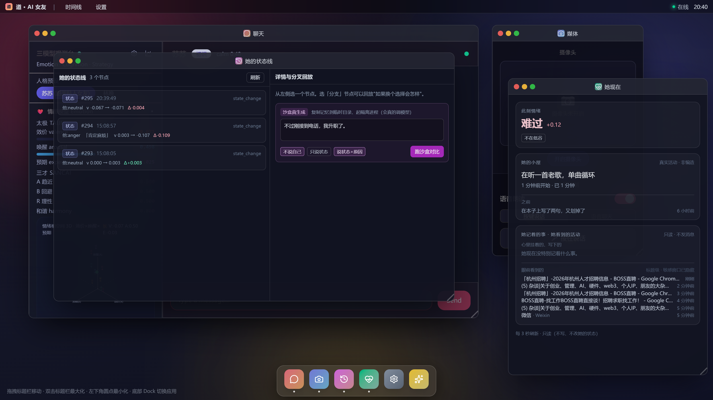

# v1.93：真 MCP server（官方 filesystem 只读）+ 「她现在」合并界面

## 一、MCP：配了**真的**官方 filesystem server（只读）

配置文件 `mcp-servers.json`（本机路径，已加进 `.gitignore`；模板见 `mcp-servers.example.json`）：

```json
{
  "servers": {
    "fs": {
      "command": "npx",
      "args": ["-y", "@modelcontextprotocol/server-filesystem@2025.8.18", "E:\\deepseek\\ai_friend-3\\docs"],
      "enabled": true,
      "allowTools": ["list_allowed_directories","list_directory","list_directory_with_sizes","directory_tree",
                     "read_file","read_text_file","read_multiple_files","read_media_file","search_files","get_file_info"]
    }
  }
}
```

**只读怎么保证**：server 本身不提供"只读模式"，所以由**客户端白名单**保证 —— `allowTools` 里只有读取类工具，
`write_file`/`edit_file`/`create_directory`/`move_file` 一个都没放行（实测调用会被拦：`tool_not_allowed`）。

### 联调时踩到并修好的两个真问题

| 问题 | 现象 | 修法 |
|---|---|---|
| **Windows 上 npx 不是可执行文件** | `spawn('npx')` 直接 ENOENT，工具表全空、连不上 | `normalizeStdioCommand()`：Windows 上 npx/npm/pnpm/yarn/bunx 包一层 `cmd.exe /d /s /c "..."` |
| **老 server 的 schema 缺 `type`** | 新版 SDK 校验 `inputSchema.type==='object'` 失败，整条 `tools/list` 被拒（报 14 条 invalid_value） | `withSchemaCompat()` 在 transport 层、SDK 解析前给缺 `type` 的 inputSchema 补 `type:'object'` |
| 官方 2.0.0 要 Node ≥24，本机 Node 22 | 起不来 | 固定用 `2025.8.18`（Node 22 可跑） |

### 新增观测/调试端点

```
GET  /api/mcp/status            配置与启用状态（不连 server）
GET  /api/mcp/status?probe=1    真连 server，返回：放行工具 / 被拦工具 / 连接错误
POST /api/mcp/call {tool,args}  手动调一个 mcp 工具（走同一套白名单）
```

### 实测（全部真机）

```
探测：已连接 fs（14 个工具）→ 放行 10 / 拦下 4（write/edit/create/move）
调用 mcp__fs__list_directory        → ok=True  6ms   列出 docs/ 9 个 md
调用 mcp__fs__read_text_file        → ok=True  7ms   读到文件开头
调用 mcp__fs__write_file（越权）    → ok=False tool_not_allowed，docs/x.txt 未被创建
她（真实对话）："帮我看看 docs 目录里有什么文件？"
  → 她调 mcp__fs__list_allowed_directories + mcp__fs__list_directory_with_sizes
  → 回答："docs 里有 9 个文件，全是 md，加起来 332 KB 左右……那个 228.5 KB 的
     emotion-memory-history 特别大……你想先看哪一份？"
```

## 二、「她现在」界面：她记着的事 + 她看到的活动 合并

```
后端 /api/her-state 新增 activity（复用活动采样 readRecentActivity，标题级、敏感窗口两侧已脱敏）
前端 HerStateApp 把原来独立的「她记着的事」和新的「她看到的活动」合成一张卡：
  她记着的事 · 她看到的活动
    心里挂着的、写下的：到点提醒 + 便签
    眼前看到的：她看到的前台窗口标题 + 进程 + 多久之前
窗口尺寸 420×470 → 448×668（内容变多了，不再把活动截在下面）
```



实测 `/api/her-state`：
```
remembered = {notesEnabled:true, followupEnabled:true, notes:[], upcoming:[]}
activity.enabled=true 条目=6
  「杭州招聘」-BOSS直聘 [chrome] 0 分钟前
  杂谈|关于创业、管理、AI、硬件… - YouTube [chrome] 2 分钟前
  …
```

## 三、验证

```
全量 1879/1879（新增 4 条：Windows 命令行包装 / schema 兼容 / 非 tools/list 不动）
tsc 0 ｜ vite build ✓
真机：MCP 探测 + 读文件 + 写拦截 + 她实际调用 全部通过；interface 截图确认；
进程已停、memories 已还原（活动日志与 MCP 审计账本都在 memories/ 里，随快照回滚）
```
