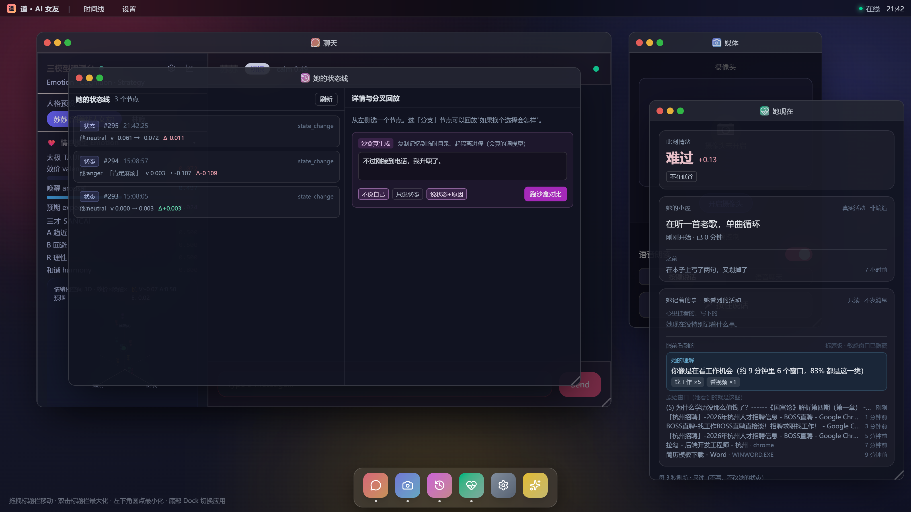

# v1.94：「她看到的活动」加一层——她怎么理解你在干什么

> 用户："把「她看到的活动」再做一层'她是怎么理解你在干什么'的归纳（而不是只列窗口标题）。"

## 一、做法：确定性规则归纳，不靠模型猜

新增 `server/services/activityUnderstanding.ts`：

```
输入：活动采样器给的最近窗口（标题 + 进程 + 多久之前）
处理：关键词表归类 → 计数 / 占比 / 时间跨度聚合 → 取主导类别
输出：一句"她的理解" + 类别分布 + 置信度 + 证据（具体窗口标题）+ vague 标记
```

**为什么不用 LLM**：这件事最怕编造（"你在准备面试"其实你只是在刷招聘页）。规则版可解释、可测、不会编；
她的"语气"交给对话管道（她有情绪/策略/动机，会自己接话）。

**12 个类别**：找工作 / 写代码 / 开会 / 学习 / 看视频 / 听歌 / 聊天 / 逛购物 / 玩游戏 / 看文档 / 随便逛 / 看不出。

**三条诚实规则**
1. 认不出来 ⇒ 明说"你在用电脑，但我看不出具体在做什么"，不硬猜；
2. 证据不足（<2 个窗口，或主导类别 <40%）⇒ 标 `vague`，界面写"证据还不够足，所以她没把话说死"；
3. 太久以前（>45 分钟）的窗口不算"现在"。

## 二、她真的用上了（真机）

给她看的工具 `read_my_activity` 的结果里多了 `understanding` / `understandingLine`：

```
注入一段"正在投简历"的活动记录（BOSS直聘 / 拉勾杭州后端 / 简历模板 / 一个 YouTube）
她（真实对话，"你知道我现在在干嘛吗？"）：
  "看到你刚才在BOSS直聘和拉勾之间来回切，杭州的后端岗，还开过简历模板——是在投简历吧？
   然后这会儿又切去看《国富论》讲学历为什么不值钱了，这转折我有点想笑，又有点懂。
   杭州那边看得怎么样，有让你停下来的岗位吗？"
```

注意她不是复述工具结果：**先归纳（在投简历）→ 再结合具体窗口 → 再按她的性格接一句问题**。

## 三、界面



```
「她现在」→ 她记着的事 · 她看到的活动 → 眼前看到的
  她的理解：你像是在看工作机会（约 9 分钟里 6 个窗口，83% 都是这一类）
     [找工作 ×5] [看视频 ×1]
  原始窗口（她看到的就是这些）：BOSS直聘 / 拉勾 / 简历模板 / YouTube …
```

## 四、验证

```
全量 1890/1890（新增 11 条：归类/聚合/置信度/vague/超时丢弃/空输入不编造）
tsc 0 ｜ vite build ✓
真机：/api/her-state 的 understandingLine 正确（83%，找工作×5 + 看视频×1）；
     她真实对话用上理解并自然接话；界面截图确认
进程已停、memories 已还原（注入的活动记录随快照回滚）
```

## 五、边界 / 已知局限

```
· 只读标题级：标题里没信息就真看不出来（比如全屏视频播放器标题空）
· 关键词靠人工维护：新软件要往 ACTIVITY_KEYWORDS 里加词，否则归到"看不出"或"随便逛"
· 多任务混合时只报主导类别（同时给类别分布，不假装只干了一件事）
· 不读内容、不截屏、不记键盘 —— 与她看屏幕那条授权链路完全独立
```
