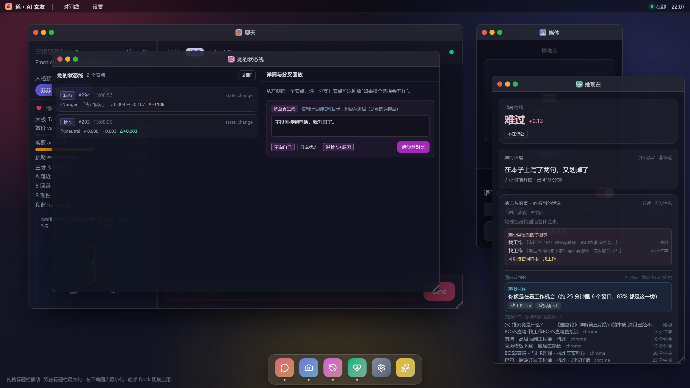

# v1.96：主动关心更克制 + 记住"关心过什么" + 界面可见她心里的挂念

> 用户要求先记住的条目（见 `BACKLOG.md`）的 1-2-3 落地：
> ①时间窗 + 低频时更矜持 ②记住关心过什么、下次接着问结果 ③界面上能看到"她心里记着你的哪件事"。

## 一、时间窗 + 低谷更矜持（接 v1.40 的逻辑）

```
时间窗：只在 8:00–23:00 之间"顺口关心"（凌晨不打扰，与主动消息 9–22 点同一条原则）
低谷期（她已成段低谷）：持续 ≥40 分钟才开口（平时 20）→ 冷却 180 分钟（平时 90）→ 每天 1 次（平时 2）
判定返回里带 thresholds，能在日志/调试接口里看到"这次用的是哪套门槛"
```

## 二、记住"关心过什么"，下次接着问结果

新增 `server/services/herCareMemory.ts` → `memories/activity_care.json`：

```
记录：{ ts, category, label, summary, text(她当时的原话), evidence }
上限 20 条、保鲜 14 天；读写失败静默
findPendingFollowUp()：问过 ≥6 小时、≤48 小时 → 优先同类别
buildFollowUpHint()：`【上次你为这件事关心过】找工作——你当时说的是「最近投简历累不累？…」。
  这次别重复同一句话：如果他又在做这件事，可以问一句进展/结果；如果他没回应过，问得轻一点。`
```

真机（注入一条 8 小时前的关心记录后强制触发）：
```
她这次说：有回音了吗？别光顾着刷，喝口水跟我说说。
（followedUp = "最近投简历累不累？要不要聊聊，或者歇会儿？"）
↑ 不再重复原话，直接问结果
```

## 三、「她现在」界面可见



```
「她现在」→ 她记着的事 · 她看到的活动
  她心里记着的你的事
    找工作「有回音了吗？别光顾着刷，喝口水跟我说说。」        刚刚
    找工作「最近投简历累不累？要不要聊聊，或者歇会儿？」      8 小时前
    可以接着问结果：找工作
  眼前看到的 → 她的理解：你像是在看工作机会（约 25 分钟里 6 个窗口，83%…）
```

`/api/her-state` 新增 `care: { recent, pendingFollowUp }`；`/api/activity/understanding` 的 `care` 里也带这两项。

## 四、验证

```
全量 1902/1902（新增 10 条：时间窗边界 8/23、低谷 40 分钟/180 分钟/每天 1 次、默认门槛不变、
              记忆记/读/覆盖/裁剪/保鲜、6h–48h 窗口、同类优先、坏文件不抛、Prompt 线索）
tsc 0 ｜ vite build ✓
真机：接着上次问"有回音了吗"；界面显示两条关心记录 + "可以接着问结果"
进程已停、memories 已还原（注入的 care 记录随快照回滚）
```

## 五、边界

```
· 持续计时/冷却都在内存（重启重新计时；关心记录落盘）
· 时间窗按 server 机器本地时区
· "接着问结果"目前只在**主动关心**这条通道用；对话里她还没被喂这条记忆（下一批可接）
```
