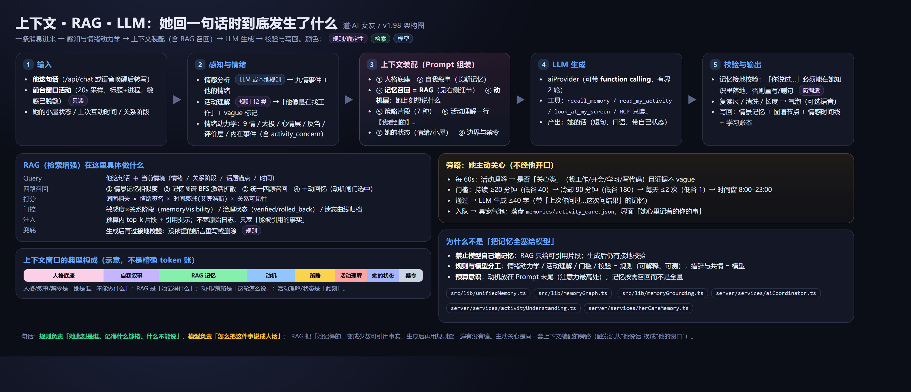

# v1.98：上下文 · RAG · LLM 的逻辑（图文）



> 一句话：**规则负责「她此刻是谁、记得什么够格、什么不能说」；模型负责「怎么把这件事说成人话」。**
> RAG 把「她记得的」压缩成少数**可引用事实**，生成后再用规则查一遍有没有编。
> 主动关心是同一套上下文装配的**旁路**：触发源从「他说话」换成「他的窗口」。

## 一、一轮对话的五个阶段

### ① 输入
- 他这句话（`/api/chat`，或语音唤醒后转写）
- 前台窗口活动：`scripts/activity-sampler.ps1` 每 20s 写一条（标题 + 进程名，**不记键盘/不截屏/不读剪贴板**，敏感词已替换）
- 她的小屋状态 / 上次互动时间 / 关系阶段

### ② 感知与情绪（大部分是规则）
- 情感分析：LLM 或本地规则 → 九情事件 + 他的情绪（`emotionCanonical` 归一）
- 活动理解（纯规则，12 类）：`server/services/activityUnderstanding.ts` → 「他在看工作机会」+ **vague 标记**（证据不足就不把话说死）
- 情绪动力学：`src/lib/emotionEngine.ts`（九情 + 太极）、`moodLayer`（12h 底色）、`rumination`（反刍）、`appraisal`（这件事对**她**意味着什么）、`emotionInternal`（内在事件，含 v1.95 的 `activity_concern`）
- 产出：**她此刻的状态**（激活态读法，不是基调 argmax）

### ③ 上下文装配（Prompt 组装，`server.ts` + `aiCoordinator`）
按顺序拼进 system prompt：

| 块 | 内容 | 谁产生 |
|---|---|---|
| 人格底座 | 她是谁、说话风格、边界 | persona |
| 自我叙事 | 长期「我是什么样的人」 | 记忆叙事（可 LLM 重写，失败保留模板） |
| **记忆召回 = RAG** | 少量可引用片段 | 四路召回（见第二节） |
| 动机层 | **她此刻想说什么**（open_loop/worry/memory_echo/wish/curiosity/stance/state） | `src/lib/motive.ts` |
| 策略片段 | 这轮怎么接（7 种策略） | `src/lib/dialogueStrategy.ts` |
| 活动理解 | `【我看到的】他约 25 分钟一直在找工作：BOSS直聘 / 拉勾…` | v1.94/95 |
| 她的状态 | 情绪 + 小屋（在听歌/在本子上写字） | 状态机 |
| 禁令/边界 | 不能编、不能越界、不复读 | 规则 |

> 动机块放在**末尾**：注意力最高处，且它是「这轮开口的理由」。

### ④ LLM 生成
- `aiProvider` 调模型；可带 **function calling**（有界 2 轮、最多 4 次工具调用）
- 工具是「去查」而不是「自由发挥」：`recall_memory` / `read_my_activity` / `look_at_my_screen` / `read_my_notes` / MCP 只读文件工具等
- 产出：她的话（短句、口语、可带她自己状态）

### ⑤ 校验与输出（规则兜底）
- **记忆接地校验**（`src/lib/memoryGrounding.ts`）：凡「你说过/我记得」这类**断言**，必须能在她的知识语料里落地；覆盖率 <0.6 → 带着事实清单重写一次 → 仍不落地**删掉那半句**。提问放行（"面试有结果了吗？"不是断言）。
- 复读尺 / 清洗 / 长度
- 写回：情景记忆 + 图谱节点 + 情感时间线 + 学习账本

## 二、RAG 在这里具体做什么（`src/lib/unifiedMemory.ts` 等）

```
Query  = 他这句话 ⊕ 当前情境（情绪 / 关系阶段 / 话题锚点 / 时间）
召回   = ① 情景记忆相似  ② 记忆图谱 BFS 激活扩散  ③ 统一四源召回  ④ 主动回忆（动机闸门选中）
打分   = 词面相关 × 情绪签名 × 时间衰减（艾宾浩斯） × 关系可见性
门控   = 敏感度×关系阶段（memoryVisibility）/ 治理状态 verified|rolled_back / 遗忘归档
注入   = 预算内 top-k 片段 + 引用提示（不塞原始日志，只塞「能被引用的事实」）
兜底   = 生成后再过接地校验：没依据的断言重写或删除
```

**为什么不是「把记忆全塞给模型」**：
1. 塞全量会挤掉人格/策略/动机（预算有限），且模型更容易编；
2. 规则能明确说「这条记忆够格进上下文吗」（治理状态、敏感度、遗忘）；
3. 生成后还有一道确定性检查，「编了」会被抓。

## 三、旁路：她主动关心（v1.95~v1.98）

```
每 60s：活动理解 → 关心类？（找工作/开会/学习/写代码）且不 vague
门槛：持续 ≥20 分钟（低谷 40）→ 冷却 90 分钟（180）→ 每天 ≤2 次（1）→ 时间窗 8:00–23:00
通过：LLM 生成 ≤40 字（若上次关心过 → 带「别重复上次那句，问进展」）
出口：队列 → 桌宠气泡；落盘 memories/activity_care.json；界面「她心里记着的你的事」
```

## 四、这次还验证了「主动关心」真的会自然触发

用可调门槛（v1.98 新增 env，仅验证用）：

```
CARE_SUSTAIN_MINUTES=1  CARE_COOLDOWN_MINUTES=1  CARE_MAX_PER_DAY=5
→ 注入"持续找工作"的窗口 → 定时器自己跑，不用 force：
   [22:40:51] streak samples=1
   [22:41:46] streak samples=1（还在等）
   [22:42:41] samples=2, caresToday=1  ← 触发
   [ActivityCare] 已入队（sustained_job）：最近找工作累不累呀，要不要休息一下？
   memories/activity_care.json: [job] 最近找工作累不累呀，要不要休息一下？ (22:41:47)
   消息队列被桌宠取走 → 气泡显示；her-state care.recent 同步
```

验证完已还原活动日志、删除这条关心记录、恢复正常门槛重启（应用保持运行）。
调门槛不用改代码：`.env` 里设 `CARE_SUSTAIN_MINUTES` / `CARE_COOLDOWN_MINUTES` / `CARE_MAX_PER_DAY`。
