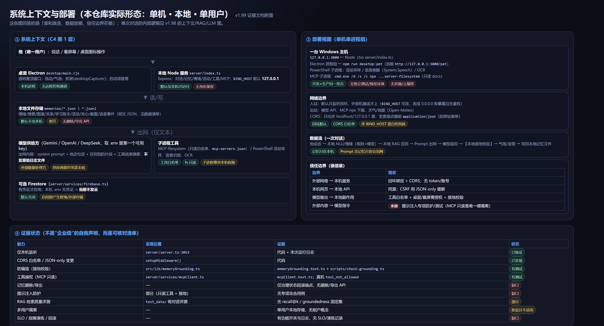

# v1.99：把「企业级」问题落成证据（本仓库实际形态：单机 · 本地 · 单用户）

> 回应上一轮的评审：v1.98 那张图是**产品逻辑/单次请求**，不能证明企业级。
> 这份文档不再画新业务图，而是做三件事：**①说清这个仓库真实是什么形态 ②把每类主张落到证据 ③标出缺口**。
> 结论先行：**这不是一个多租户 SaaS**，按"企业级 SaaS"标准评估，缺的不少；按"本机个人使用"标准，
> 关键边界（回环监听、工具白名单、授权、接地）已有实现与测试，**数据生命周期与提示注入是首要缺口**。

## 一、按你的九个维度逐条对照

| 维度 | 本仓库实际状态 | 证据 | 结论 |
|---|---|---|---|
| 系统边界与部署 | 单机：Electron + 本地 Node(`127.0.0.1:3000`) + 本地 JSON 文件 + 一个模型 API；无容器/云编排 | `server/server.ts:3053`（默认绑回环）、`desktop/main.cjs`、`server/index.ts` | **单机形态已明确**；无测试/预发环境隔离 ← 缺口 |
| 身份与权限 | 无账号/无 token；靠"只绑回环 + CORS 白名单 + JSON-only 变更"建立本机信任边界。工具侧有白名单与授权（MCP 只读、截屏需允许、桌面写操作需点允许） | `setupMiddleware()`、`mcpClient.ts`、`screenWatch.ts`、`desktopItems.ts` | **单用户按设计无鉴权**；若改 `BIND_HOST=0.0.0.0` 即暴露且无鉴权 ← 风险 |
| 隐私与数据生命周期 | 数据全在 `memories/*.json|jsonl`（明文）：情绪/情景/图谱/关系/活动/关心/截图/语音事件；部分有保留期（截图 7 天、关心 20 条/14 天、便签 512KB 滚动、时间线 2MB 滚动）；**无删除/导出 API**，只有治理状态回滚 | 数据清单见 `data-lifecycle-and-permissions.md`；`screenWatch.ts:29,164-173`；`herCareMemory.ts:17-18` | **缺口：删除/导出/纠正没有入口**；Firestore 有凭证才启用（本机无凭证 ⇒ 不发云） |
| 安全威胁 | 有：CORS、JSON-only、速率限制（chat 30/min、vision 12/min）、工具白名单、文件系统只读、截屏敏感窗口拒绝、接地校验；**无**：提示注入专项防护与测试、外部内容（OCR/MCP 文件/桌面文件名）当数据处理的显式标注 | `setupMiddleware():347-385`、`mcpClient.test.ts`、`memoryGrounding.test.ts` | **部分**；提示注入 ← 缺口（详见 `threat-model.md`） |
| 记忆质量与纠错 | 有：治理状态机（proposed→supported→verified/rolled_back）、遗忘曲线、来源/时间戳、可见性门控、图谱归档同步；**无**：用户侧"改/删/撤销"入口，删除传播到图谱/索引未实现（只有归档同步） | `memoryGovernance.ts`、`memoryEnhancer.ts`、`memoryVisibility.ts`、`episodicGraphBackfill.test.ts` | **部分**；纠错闭环 ← 缺口 |
| AI 质量与安全 | 有：接地校验（断言必须落地，覆盖率 <0.6 重写/删句）、复读尺、危机策略（`crisis`）、200 条种子输入 + LLM Judge 评测资产、多个 A/B 脚本；**无**：RAG 检索层固定评测集（recall@k / groundedness 分开量） | `memoryGrounding.ts` + 测试；`dialogueStrategy.ts` 的 `crisis`；`test_data/`；`scripts/ab-*.ts` | **部分**；检索评测 ← 缺口 |
| 可靠性与成本 | 有：模型调用重试（`generateResponse` 失败重试一次）、网络抓取 curl 回退、超时与限频、内存/进程实测（server 39MB）；**无**：SLO/SLI、负载与故障演练、单位请求成本报告 | `server.ts:1501,1523`；实测见 v1.97 报告 | **部分**；SLO/演练 ← 缺口 |
| 运维与变更治理 | 有：结构化日志（`[Mood]`/`[Grounding]`/`[ActivityCare]` 等）、大量功能开关（可回退）、git 提交与 CLAUDE 版本记录、每次改动跑全量测试；**无**：监控告警、发布/回滚流程文档、事故复盘模板 | `CLAUDE.md` 开关表；提交历史；`artifacts/v1.*` | **部分**；告警/流程 ← 缺口 |
| 责任与合规 | 有：数据默认不出本机、`.env` 不入库、外部数据处理方仅模型 API；**无**：DPIA/合规评估、供应商数据处理条款核查、未成年人/敏感信息专项 | `.gitignore`；本机无 Firestore 凭证 | **缺口（需专业评估）** |

## 二、这张图之外、现在就能给出的证据

1. **主张—证据台账**：`claim-evidence-ledger.md`（20 条主张，逐条给实现位置/测试/状态）。
2. **数据与权限**：`data-lifecycle-and-permissions.md`（数据清单 + 保留期 + 谁能读 + 删除现状）。
3. **威胁模型**：`threat-model.md`（STRIDE 简表 + 具体攻击用例 + 已有缓解 + 未验证项）。
4. **系统与部署视图**：本文附图（谁连谁 / 数据在哪 / 信任边界）。
5. **AI 逻辑图**：`../v1.98/context-rag-llm.md`（不是企业级证明，是业务流程说明）。

## 三、要真按"企业级"申报，必须先补的四件事（按优先级）

| 优先级 | 补什么 | 验收方式 |
|---|---|---|
| P0 | 数据删除/导出/纠正入口 + 删除传播（图谱/索引/备份/日志） | 两个测试账号 + 删除后全链路断言 |
| P0 | 提示注入与工具越权攻击用例（恶意记忆/OCR 文本/MCP 文件/文件名） | 可复现攻击脚本 + 修复记录 |
| P1 | RAG 固定评测集（检索与生成分开量） | recall@k / groundedness / completeness 报表 |
| P1 | SLO + 故障演练 + 变更回滚流程 | SLI 指标、演练记录、回滚演练 |

> 备注：多用户隔离在本仓库**不是"没做"，而是产品形态是单机单用户**。
> 一旦要变成多租户，需要先做数据分区（记忆/图谱/账本按用户命名空间）与鉴权，这属于**产品形态变更**，不是补个中间件。
