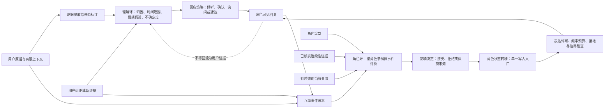

# 双环情感模型：设计方法、验证方法与落地路线

审查基线：2026-11-25  
适用项目：AI Friend 与 MEGM 的双环情感模型实验

## 1. 目标与边界

双环模型要把两件不同的事分开处理：

1. **理解环**：从用户原话和可核对上下文中，判断用户可能表达了什么、证据是什么、有哪些替代解释，以及判断有多不确定。
2. **角色环**：判断一个互动事件对角色自己的目标、边界、当前关切和已有状态意味着什么，再决定角色状态是否变化，以及是否适合表达。

用户情绪分析是关于用户状态的假设；角色状态是软件角色模拟器维护的内部状态。用户被判断为悲伤，不能直接推导出角色也应当悲伤。角色可能选择倾听、确认或询问；只有角色自己的参照和事件证据支持时，才可以产生角色侧的关切候选。

这里的“角色情感”是一个有状态、有来源、能回放的软件模型。项目不能由此证明 AI 具有意识、主观感受或人类式情感。设计和产品描述都应保留这条边界。

双环表示两个相互传递信息的闭环职责，不要求运行两个独立 LLM Agent。把模型调用拆成两个 Agent 可能增加成本、延迟和相互污染，却不自动提高可复现性。首选实现是有版本的输入/输出契约、纯函数评价、单一状态转移入口和受控表达门。

## 2. 架构总览



理解环的输出可以改变“怎么回应用户”。它不会直接输出角色情绪 delta。角色环只接收带身份、时间、来源和证据的事件候选；无法确认时应返回 `unknown`、`ambiguous` 或 `no_reading`。

## 3. 两个环分别做什么

### 3.1 理解环：建立关于用户的可纠正假设

每轮按以下顺序处理：

1. 保留原始消息作为本轮证据，不把模型生成的回复混入用户证据。
2. 拆分事实、引述、说话者、情绪对象、时间范围、否定、假设和第三方信息。
3. 产生零到多个情绪假设。每个假设都绑定证据 ID、主体、时间范围、来源类型和不确定度；没有证据时允许无判断。
4. 同时保留合理的替代解释。不要把单一情绪标签当作用户事实。
5. 将理解结果用于回应策略。低证据或相互矛盾时优先接住明确内容、温和询问或保持未知。
6. 用户纠正时更新假设并保留纠正记录；不能继续重复已被否认的判断。

建议区分以下报告类型：`explicit_self_report`、`quoted_or_third_party`、`inferred`、`mixed`、`unknown`。还要区分“用户在说谁”和“谁报告了这份情绪”。“我朋友很害怕”不能转成用户害怕；引用里的情绪也不能仅因出现在用户消息中就算作用户自述。

时间范围必须独立建模。“我这周一直很难受”是用户本轮明确报告的区间状态，不是某个瞬间刚发生的情绪；历史回忆和假设句也不能自动升级为当前状态。

### 3.2 角色环：以角色自身参照解释事件

角色侧评价不能只读用户的情绪标签。至少需要三个不同来源的参照：

| 参照 | 用途 | 约束 |
|---|---|---|
| `role_constitution` | 角色稳定价值、目标和硬边界 | 由项目负责人确认、版本化；未确认项是 `unknown` |
| `continuity_evidence` | 已核实的关系、经历、身份连续性和角色世界事件 | 需保留来源；生成式 `IdentityNarrative` 只是摘要，不能单独成为宪章 |
| `current_concerns` | 当前阶段有时效的动机、关注或任务 | 必须有事件来源和有效期，不能升级为永久人格 |

角色宪章是角色环的锚点。当前代码没有找到一份独立、经项目负责人确认并版本化的 `RoleConstitution`。在它建立之前，不能声称角色环已具备稳定的“角色自己的目标”。缺少匹配参照时返回 `no_reading`，只允许理解环继续影响回应策略。

角色活动模拟器、虚拟小镇或卧室可以提供**角色世界中的模拟事件**，但不得伪装成现实活动。模拟事件应带 `source=character_simulation`、时间和事件 ID；表达器也必须明确其虚拟属性。

## 4. 两环之间的最小耦合契约

### 4.1 只传递事件证据，不传递角色情绪指令

理解环输出到角色环的最小消息应类似：

```ts
interface AffectBridgeInput {
  eventId: string;
  subject: 'user' | 'third_party' | 'multiple' | 'unknown';
  reportKind:
    | 'explicit_self_report'
    | 'quoted_or_third_party'
    | 'inferred'
    | 'mixed'
    | 'unknown';
  temporalScope: 'moment' | 'interval' | 'historical' | 'hypothetical' | 'unknown';
  emotion: string;
  evidenceIds: string[];
  causeEvidenceIds: string[];
  inferenceUncertainty: number | 'unknown';
  userCorrection?: boolean;
}
```

桥接消息不能带“角色应该悲伤/担心”的指令，也不能直接带一个角色状态增量。角色情绪只由角色环参照和状态转移规则计算。

### 4.2 影子阶段的决定规则

新增桥接的 v0 应按拒绝优先原则工作：

1. 用户拒绝继续谈情绪时，不继续做情绪拓展。
2. 主体是第三方、多主体或未知，或报告混合、引述、假设、历史状态时，返回 `ambiguous_affect_context` 或 `no_reading`。
3. 仅当用户本人明确自述、证据绑定当前消息、时间范围有效且不确定度足够低时，才产生 `user_affect_disclosed` 候选。
4. 角色宪章未确认、当前关切没有来源，或证据与角色关切没有可审计匹配时，返回 `no_reading`。
5. 若匹配成立，v0 只记录 `care_response_candidate`、理由、匹配证据和事件关联。`proposedStateDelta` 固定为 `0`，不写线上角色情绪。
6. 同一事件按 `eventId + subject + appraisalVersion` 幂等处理，避免重试或多轮回放造成重复累加。

“用户难过”默认只表示回应策略需要照顾用户，不自动造成角色悲伤。任何以后允许的非零角色影响，都需要独立的有界状态转移实验和预注册规则，不能临时拍阈值。

### 4.3 未知值、确定度与不确定度

- `certainty` 描述输入事实或评价本身是否确定。
- `inferenceUncertainty` 描述情绪判断是否不确定。
- 两者相关但不可互换；没有校准时只作序位诊断，不叫概率。
- `unknown` 不得静默填成 `neutral`、0 分或“没有情绪”。
- 明确拒绝、引述、第三方、讽刺、混合情绪和时间范围不清必须有独立状态，不用缺失值藏起来。

## 5. 角色状态与表达如何衔接

角色状态引擎负责状态更新；表达器负责选择是否表达。表达不是情绪状态的证据，也不能再次作为外部事件回灌。

每轮状态链需记录输入快照、阶段顺序、各来源 delta、状态前后值、事件 ID 和规则版本。未来的目标是由一个模块负责最终状态写入；当前系统还不是单一写入者，不能把该目标描述为现状。

表达层的建议顺序：

1. 先处理用户本轮需要；用户明确负面或危机时，角色自我表达应让位。
2. 检查角色状态是否超过可表达死区，是否存在主导或足够清晰的状态。
3. 检查该状态是否可回溯到角色自身事件或已批准的角色参照。
4. 检查频率预算、表达边界和长度；没有许可就不表达。
5. 表达原因只能来自已绑定证据；原因未知时可以说不清楚，不允许补造现实经历。
6. 输出后把角色表达留在角色侧日志，不将其伪装成用户反馈。

现有 `emotionExpression`、`expressionPlan` 和最终回复护栏可以作为表达层基础，但它们不能代替双环因果验证。对话体验 A/B 与状态写入 A/B 必须分开，否则无法知道收益来自何处。

## 6. 当前代码现状：已有机制与缺口

### 6.1 线上既有写入路径

当前 `aiCoordinator` / `characterEmotionStage` 依次处理时间衰减、直接事件刺激、情绪传染、AI Friend 当前 appraisal、内在事件、mood 与 rumination 调制。每一步都可能改变同一轮的 `EmotionState`；`DISABLE_APPRAISAL=true` 只关闭现有 appraisal，不关闭 contagion。因此现状不是已经隔离的双环，也不是单一状态写入者。

现有路径审计记录在[当前情绪写入链审计](../artifacts/emotion-learning/current-emotion-write-path-audit-v1.md)，纯函数对照见[验证记录](../artifacts/emotion-learning/current-emotion-write-path-verification-v1.md)。对照表明 appraisal 关闭时 contagion 仍改变状态；这只是固定输入下的 stage 级证据，不能代表完整服务因果效果。

### 6.2 双环相关的实验代码

| 部分 | 当前状态 | 不能据此声称 |
|---|---|---|
| `emotionAnalyzer` 的本地/LLM 情绪分析和归因裁决 | 现有在线分析链 | 情绪推断已是事实或已完全校准 |
| `analyzeAffectBridgeShadow` | 有模式规则、主体/报告者、证据、时间范围和保守映射；分析结果作为只读诊断字段 | 已实现 MEGM 完整 appraisal 或已证明分类准确 |
| `evaluateAffectBridgeShadow` | 纯函数 gate，支持 abstain、角色参照匹配和 `delta=0`；当前主要由测试与 pilot 脚本调用 | 已连接线上角色状态写入 |
| `activityEmotionShadow` | 本地活动关切的影子窗口、采样和时间门限 | 活动关切已经改变情绪状态或回应 |
| `commitDualLoopEmotionEventAsync` | 本地持久化辅助器，支持事件键去重、锁和原子快照；当前调用点是离线 replay script | 已作为实时聊天的生产状态写入路径 |
| 双环 Demo v0.7 | 展示现状写入路径与目标影子桥边界 | 实时运行了完整双环或产生实际收益 |

以上分别在 [双环架构设计](../artifacts/emotion-learning/dual-loop-emotion-architecture-v1.md) 与 [双环 Demo v0.7](../artifacts/emotion-learning/dual-loop-emotion-demo-v0.7.html) 中记录。

### 6.3 当前最大的未决设计前提

1. 项目负责人尚未确认角色宪章的稳定价值、目标和边界。
2. 理解环与角色环目前没有通过统一、冻结的版本化 appraisal adapter 完整连接。
3. 现有状态链有多个依次变换状态的阶段；单一写入者是目标，不是已完成事实。
4. AI 评审可帮助发现明显问题，但不能充当独立金标；尚缺独立标注者/人类仲裁的留出集。
5. 同一模型可能见过公开文学材料；文学资料适合开发和证据练习，不能单独当盲测答案集。

## 7. 推荐实施方法

### 7.0 方法与工具怎么配合

| 方法 | 项目中的工具/载体 | 用途与边界 |
|---|---|---|
| 类型契约与 schema 版本 | TypeScript 接口、`affectBridgeShadow.ts` | 固定主体、来源、时间、证据和 abstain 状态；类型通过不代表分类准确 |
| 纯函数验证 | `analyzeAffectBridgeShadow`、`evaluateAffectBridgeShadow` 及其单测 | 对固定输入验证归因和拒判；不触发线上状态写入 |
| 现状调用链审计 | CodeGraph、源码逐阶段快照、审计文档 | 找出静态调用路径并核实动态开关；静态图不能替代运行时验证 |
| 确定性回放 | `scripts/run-dual-loop-shadow-replay.mjs`、固定 fixture 与版本元数据 | 重现相同事件并比较实验臂；不得混入不同初始状态或提示版本 |
| 配对消融与反事实 | 离线 runner、固定场景、A/B 结果 JSON | 估计特定机制的条件差异；必须先证明开关只改变目标机制 |
| 连续轮次与迁移评估 | 新写场景、纠正/重复事件序列、冻结留出集 | 查累积偏差和跨场景泛化；作者、调规则者与盲评者应尽量分离 |
| 成本与体验观测 | 请求数、token、延迟、错误/回退日志；独立表达盲评 | 判断质量变化是否值得成本；体验分不能替代状态因果证据 |

本项目现有实现以 TypeScript 服务和 Node 离线脚本为主。Demo HTML 是架构说明材料，不是运行时集成或效果验证工具。若模型 API 参与实验，应将模型名、版本、温度、系统提示哈希、请求数和数据处理同意记录进结果元数据；API key 只从安全环境变量读取，不能写进 fixture 或结果文件。

### 阶段 0：冻结词汇、范围和不变量

冻结 `subject`、`reportKind`、时间范围、来源、证据 ID、`unknown`、纠正和版本字段。记录哪些字段是观察事实，哪些是推断，哪些是角色侧评价。把上节硬约束写为 schema 和断言。

**通过条件：**每个字段有定义、来源和失败处理；一个值不同时承担“事实确定”和“推断置信度”。

### 阶段 1：审计 as-is 基线

逐字段记录当前 `EmotionState` 更新者和顺序；对 direct、contagion、现有 appraisal、internal、mood、rumination 做前后快照。逐个验证功能开关实际关闭了什么。

**通过条件：**有固定输入的可重放基线；关闭 appraisal 与关闭 contagion 不混为一谈；每个实验臂能说明只改变了哪个变量。

### 阶段 2：建立独立标注和隔离数据

为每个样本标注消息主体、情绪报告类型、时间范围、证据 span、替代解释、不确定性和是否应 abstain。场景作者、标注者、评审者尽量分离；冻结仲裁办法后才看 A/B 结果。

数据至少拆为开发集、规则校准集和盲测集。测试前新写的合成场景适合迁移测试；公开文学文本不可单独作为盲测答案。AI 评审分数只作辅助诊断，需报告评审模型、提示、重复次数和分歧。

**通过条件：**标注协议可由未参与写规则的人执行；字段一致率和争议类别已报告；盲测集在试验前封存。

### 阶段 3：离线纯函数与契约测试

先只测 `analyzeAffectBridgeShadow` 和 `evaluateAffectBridgeShadow`，不调用生产模型、不更新线上状态。覆盖本人自述、第三方、引述、否定、双重否定、混合、假设、历史/区间时间、拒绝讨论、未知原因和角色目标缺失。

**通过条件：**非法/有歧义输入稳定 abstain；同输入同版本得到相同输出；事件键重复不会生成第二次候选；新增 adapter 的状态 delta 永远是 0。

### 阶段 4：确定性回放和反事实

保存固定输入、初始状态、模型/提示版本、事件 ID、状态阶段快照和随机种子。单变量反事实只改变一项（例如用户明确报告的情绪或角色 concern），其余输入完全相同。

**通过条件：**回放可复现；修改指定变量以外的 prompt、记忆、初始状态或其他写入者时试验判为无效，而不是把差异解释成双环收益。

### 阶段 5：配对消融

至少区分这些臂，并验证每臂真实关闭的模块：

| 实验臂 | 目的 |
|---|---|
| 当前生产路径 | 建立 as-is baseline |
| 关闭现有 AI Friend appraisal，保留 contagion | 估计该 appraisal 的条件增量；不代表无角色状态传播 |
| 隔离 runner 关闭 contagion，保留其他机制 | 估计 contagion 条件增量 |
| 关闭 contagion 与现有 appraisal | 诊断二者是否互相影响；不是上线候选 |
| 影子桥，仅记录、delta=0 | 检查新桥接归因与 abstention，不估计状态收益 |

不要把“关掉 `DISABLE_APPRAISAL`”说成“双环隔离”。开关名、运行配置和最终阶段差分都要进入结果文件。

### 阶段 6：连续多轮稳定性

单轮正确不代表闭环稳定。按时间顺序运行多轮场景，加入用户否认/纠正、第三方信息、延迟回复、重复事件、用户改变主题和角色自身模拟事件。检查情绪误判是否累积、表达是否自我强化、角色状态是否漂移。

**通过条件：**同一事件不会被重复写入；纠正能停止旧假设持续传播；角色自己的输出不会成为下一轮的用户情绪证据；状态不会在无新证据时自行放大。

### 阶段 7：迁移与表达质量评估

用新作者撰写、未参与规则调试的场景检查迁移；再单独评估表达自然度、是否回应用户、是否编造角色经历、是否强行自我披露。表达质量与状态因果收益分开报告。达到预注册门槛且无安全回退后，才讨论非零状态影响实验。

**通过条件：**独立留出集结果、错误案例、失败率、拒判率、模型调用数、延迟与成本一并公开；对主指标的验收阈值在看结果之前确定。

### 阶段 8：渐进接入

顺序是：离线回放 → 只读影子 → 受控 opt-in 小流量 → 有界状态写入试验 → 生产默认。每一级都有开关、回退版本、数据删除策略和错误预算。未经前一级验收，不跳级。

## 8. 评估指标

指标必须由预注册协议固定定义；建议至少分别报告：

### 理解环

- 主体/报告者归因错误率。
- 情绪类别宏平均指标及混合/未知类别表现。
- evidence span 是否确实支持该假设。
- 该 abstain 的样本是否拒判；报告覆盖率和选择性错误率，不能只看“已判样本准确率”。
- 用户纠正后的更新正确率及旧假设复现率。

### 角色环

- 每个阶段的状态 delta 和来源分解。
- 角色 appraisal 与 `role_constitution` / `current_concerns` 的证据匹配率。
- 重复事件幂等率、跨轮状态漂移、无输入时的稳定性。
- “用户情绪直接复制到角色状态”与“角色自我输出回流为用户证据”的违规率。

### 表达与系统成本

- 是否先回应用户当下需要、表达是否简短自然、是否越过关系边界、是否编造现实活动。
- 用户不适/纠正信号；AI 评审只作辅助并公开评审分歧。
- 每轮模型请求数、prompt/completion tokens、延迟 p50/p95、失败率和回退率。

准确率提升不能抵消隐私泄漏、错误主体归因、反复无依据自述或状态自激。安全指标应作为硬门槛，而非加权分数里的一个小项。

## 9. 关键风险与控制

| 风险 | 典型失效 | 控制手段 |
|---|---|---|
| 主体污染 | 把朋友/引用中的情绪当成用户情绪 | 分开 subject 与 reportedBy；歧义即 abstain |
| 情绪镜像 | 用户 sad 直接变成角色 sad | 桥只传事件证据；角色 appraisal 必须匹配自身目标 |
| 自激回路 | 角色表达被误当成用户反馈 | 来源类型隔离；输出不回流到理解环 |
| 默认值伪造 | `unknown` 被补成 neutral/中性评价 | schema 明确 unknown；缺失时无判断 |
| 角色宪章漂移 | 用生成摘要冒充稳定价值 | 负责人确认、版本化；摘要只作 continuity evidence |
| 因果归因错误 | 误把同时发生的多个写入者归因于新桥 | as-is 快照、隔离 runner、逐字段消融 |
| 评测污染 | 作者兼评审、公开作品进入盲测 | 角色分离、私有留出、预注册、报告模型局限 |
| 过度调用 | 为“第二个环”额外调用模型但无收益 | 先用现有分析结果和本地纯函数；以成本/延迟为指标 |
| 隐私泄漏 | 原话、活动信息进入日志/公开仓库 | 证据 ID 优先、最小化保存、答案键隔离、发布前扫描 |

## 10. 当前路线与验收关口

| 次序 | 工作 | 交付物 | 未通过时的动作 |
|---|---|---|---|
| 1 | 确认角色宪章 5–8 条稳定价值/目标/边界 | 有负责人和版本的 `RoleConstitution` | 角色侧价值评价保持 `unknown/no_reading` |
| 2 | 冻结 schema、字段词典与桥接状态码 | 版本化契约与示例 | 不接任何线上角色状态 |
| 3 | 做独立标注包与盲测隔离 | 标注协议、开发/校准/盲测清单、仲裁规则 | AI 评审仅作诊断，不报金标准确率 |
| 4 | 完成 as-is 状态写入审计及开关验证 | 可重复 baseline 与每阶段快照 | 不开始因果消融 |
| 5 | 运行离线契约、反事实和 replay | 固定输入结果与失败集 | 修尺子，不调规则追分 |
| 6 | 运行配对消融和多轮稳定性 | 预注册报告、来源 delta、失败率和成本 | 保持 shadow-only |
| 7 | 独立迁移评测与表达评估 | 留出集和双盲/人评材料 | 不把 prompt 改写收益归给状态模型 |
| 8 | 小流量 opt-in，后续再试非零 delta | 回滚开关、限幅和数据删除方案 | 任一安全门失效即退回只读影子 |

## 11. 当前可以对外使用的准确表述

可以说：

> 项目实现了用户情绪理解、角色状态演化和表达约束等不同模块，并正在用只读影子桥、确定性回放和配对消融验证它们如何耦合。当前研究目标是建立有证据、可纠正、可回放的角色情感状态模拟。

不应说：双环已完全隔离、双环已证明提升情感能力、角色已具有真实主观情感、影子评估等同于生产效果。

## 12. 相关资料

- [AI Friend × MEGM 双环情感架构设计稿](../artifacts/emotion-learning/dual-loop-emotion-architecture-v1.md)
- [当前情绪状态写入链路审计](../artifacts/emotion-learning/current-emotion-write-path-audit-v1.md)
- [当前写入链验证记录](../artifacts/emotion-learning/current-emotion-write-path-verification-v1.md)
- [双环情感模型 Demo v0.7](../artifacts/emotion-learning/dual-loop-emotion-demo-v0.7.html)
- 核心实现：`server/services/affectBridgeShadow.ts`、`server/services/activityEmotionShadow.ts`、`src/lib/characterEmotionStage.ts`、`src/lib/emotionExpression.ts`、`server/persistence.ts`、`scripts/run-dual-loop-shadow-replay.mjs`
